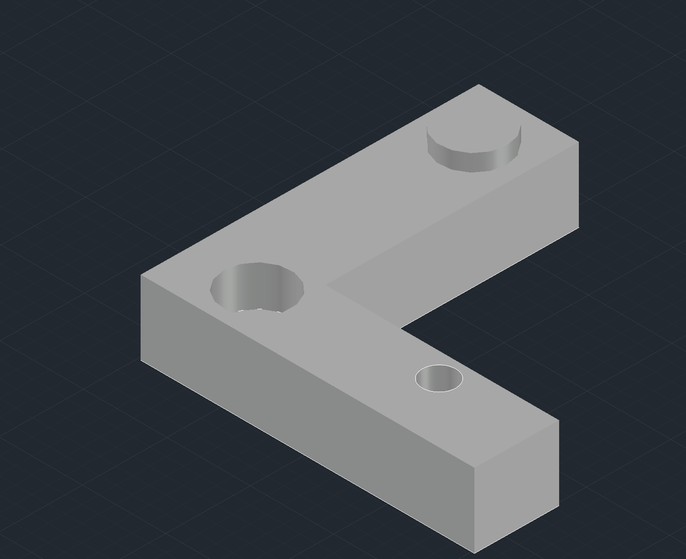

# AutoCAD Mechanical Design Portfolio

**Hemant Yadav** | B.Tech Robotics & Automation  
Medicaps University, Indore

Welcome to my CAD portfolio! This repository showcases my practice in mechanical component design, engineering drawings, and 3D modeling. These projects help me develop my understanding of geometry, dimensions, component design, and technical visualization using **AutoCAD**.

## 🛠️ Tools & Skills

- **Software:** AutoCAD
- **Mechanical Component Design**
- **2D Engineering Drawings**
- **Dimensioning & Annotation**
- **Orthographic Projection**
- **3D Model Visualization**

## 📐 Projects

### 1. Mechanical Mounting Plate

A mechanical mounting plate designed with a central circular opening and four mounting holes.

**Key features**
- Geometric layout of the plate and holes
- Dimensioned engineering drawing views
- Practice in orthographic representation and mechanical drawing

### 2. L-Shaped 3D Component

An L-shaped mechanical component created as part of my CAD design practice.

**Key features**
- L-shaped geometry and component representation
- Practice in 3D visualization and mechanical part design
- Focus on shape, proportions, and technical presentation

## 🎯 Objective

To strengthen my skills in CAD, mechanical design, engineering drawing, and manufacturing-oriented component modeling as part of my Robotics & Automation engineering journey.

## 👨‍💻 About Me

I am a B.Tech Robotics & Automation student interested in **mechanical design, industrial robotics, and manufacturing automation**. I am continuously improving my CAD and engineering skills through practical projects.

- **LinkedIn:** [hemantyadav23](https://www.linkedin.com/in/hemantyadav23)
- **GitHub:** [hemantyadav2323-ux](https://github.com/hemantyadav2323-ux)

---

*This repository documents my ongoing CAD learning and project development.*
