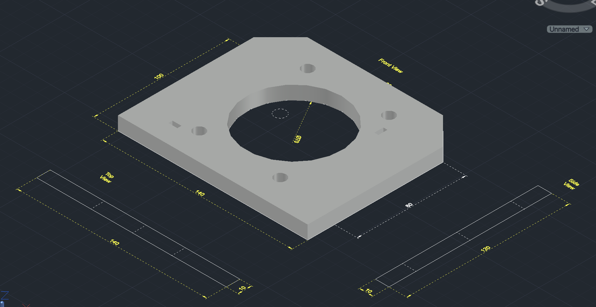

# ⚙️ CAD Drawings Portfolio

### Robotics & Automation Engineering | CAD Design

---

**Welcome to my CAD portfolio!**

A collection of my engineering drawings, CAD models, and design projects as I develop my skills in mechanical design and Robotics & Automation.

## 👨‍💻 About This Portfolio

- ⚙️ **Domain:** Robotics & Automation Engineering
- 📐 **Focus:** Engineering drawings and CAD design
- 🛠️ **Software:** AutoCAD / Fusion 360 — as applicable to each design
- 📂 **Repository:** CAD drawings, design previews, and project files

## 🖼️ CAD Design Gallery

<!-- Add your image Markdown below -->

### 🔹 Design 01 — Mounting-plate

  

*Add a short description of this design here.*

---

### 🔹 Design 02 — Your Design Name

  

*Add a short description of this design here.*

---

### 🔹 Design 03 — Your Design Name

  

*Add a short description of this design here.*

---

### 🔹 Design 04 — Your Design Name

  

*Add a short description of this design here.*

---

## 🚀 Skills & Interests

  
  
  
  

## 📈 My Engineering Journey

Continuously learning, designing, and improving through practical engineering projects.

**Design • Learn • Build • Improve**

⭐ If you find my work interesting, feel free to explore the repository!

